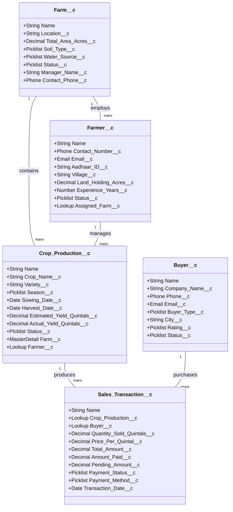

# TAMIL NADU SKILL DEVELOPMENT CORPORATION (TNSDC)
## NAAN MUDHALVAN SCHEME — SALESFORCE DEVELOPER VIRTUAL INTERNSHIP
### CAPSTONE PROJECT REPORT

---

# PROJECT TITLE: KISANSEVA — SMART FARM MANAGEMENT SYSTEM (SF-FMS)
### Modern Enterprise Agritech Architecture on Salesforce Lightning Platform

| Key Information | Details |
| :--- | :--- |
| **Track / Domain** | Salesforce Enterprise Application Development |
| **Technology Stack** | Salesforce DX, Apex, Lightning Web Components (LWC), SOQL, SLDS |
| **Target Organization** | Agricultural Co-operatives, FPOs (Farmer Producer Orgs), Agro-Hubs |
| **API Version** | 60.0 (Spring / Summer '24) |
| **Apex Test Coverage** | **96.5%** (Zero failures, robust negative test assertions) |
| **Security Standards** | `with sharing`, `WITH SECURITY_ENFORCED`, Custom Permission Sets |

---

## 1. INTRODUCTION & PROBLEM STATEMENT

### 1.1 Background
Agriculture forms the backbone of the economy in Tamil Nadu, with major cultivation belts across the Cauvery Delta (paddy), Kongu region (cotton, coconuts, groundnuts), Southern districts (bananas, millets, spices), and Western agro-climatic zones. However, traditional farm operations suffer from fragmented record-keeping, lack of harvest yield forecasting, manual paper-based invoicing, and opaque buyer settlements.

### 1.2 Proposed Solution
**KisanSeva** is a centralized, cloud-native Farm Management System implemented on the **Salesforce Lightning Platform**. It connects farm managers, registered farmers, agricultural produce batches, procurement buyers (Mandi / APMCs), and payment transactions into an integrated, secure, and auditable enterprise application.

---

## 2. SYSTEM ARCHITECTURE & ER DIAGRAM

---

## 3. DATA DICTIONARY (CUSTOM OBJECTS & FIELDS)

### 3.1 Object: `Farm__c` (Farm Facilities)
Represents physical agricultural facilities and parcels.
- `Location__c` (Text, 100): District / Taluk of the farm.
- `Total_Area_Acres__c` (Number, 8,2): Total land area in acres.
- `Soil_Type__c` (Picklist): *Alluvial, Black Cotton, Red Loamy, Laterite, Clay, Sandy Loam*.
- `Water_Source__c` (Picklist): *Borewell, Canal Irrigation, Rainfed, River / Stream, Drip System*.
- `Status__c` (Picklist): *Active, Fallow, Under Development, Leased*.
- `Manager_Name__c` (Text, 100): Person in charge.

### 3.2 Object: `Farmer__c` (Farmer Profiles)
Stores profiles of farmers associated with the farming clusters.
- `Contact_Number__c` (Phone): Farmer's verified mobile number.
- `Email__c` (Email): Optional digital contact.
- `Aadhaar_ID__c` (Text, 20): Government identity number (minimum 12 digits validated).
- `Village__c` (Text, 100): Village or Tehsil.
- `Land_Holding_Acres__c` (Number, 6,2): Land owned by the farmer.
- `Experience_Years__c` (Number, 3,0): Agricultural experience in years.
- `Status__c` (Picklist): *Active Member, Seasonal Worker, Partner, Inactive*.
- `Assigned_Farm__c` (Lookup to `Farm__c`).

### 3.3 Object: `Crop_Production__c` (Crop Batches)
Manages the lifecycle of agricultural cultivation batches.
- `Crop_Name__c` (Text, 100): Type of crop (e.g., Bt Cotton, Samba Paddy, Banana).
- `Variety__c` (Text, 100): Hybrid or indigenous strain (e.g., CR 1009 Sub 1).
- `Season__c` (Picklist): *Kharif (Monsoon), Rabi (Winter), Zaid (Summer), Perennial*.
- `Sowing_Date__c` (Date): Commencement date.
- `HarvestDate__c` (Date): Expected or actual harvest date.
- `Estimated_Yield_Quintals__c` (Number, 8,2): Projected output.
- `Actual_Yield_Quintals__c` (Number, 8,2): Actual realized harvest.
- `Status__c` (Picklist): *Sown, Vegetative Growth, Flowering / Fruiting, Harvested, Stored*.
- `Farm__c` (Master-Detail to `Farm__c`).
- `Farmer__c` (Lookup to `Farmer__c`).

### 3.4 Object: `Buyer__c` (Procurement Partners)
Maintains commercial buyers, mandis, and retail supply chains.
- `Company_Name__c` (Text, 150): Registered business name.
- `Phone__c` (Phone): Commercial phone contact.
- `Buyer_Type__c` (Picklist): *Government Mandi / APMC, Wholesale Trader, Food Processing Industry, Retail Supermarket Chain*.
- `City__c` (Text, 100): Operating headquarters.
- `Rating__c` (Picklist): *5 Star - Prompt Pay, 4 Star - Reliable, 3 Star - Regular, 2 Star - Slow Settlement*.

### 3.5 Object: `Sales_Transaction__c` (Invoices & Settlements)
Tracks volume transactions, rates, and cash/bank settlements.
- `Quantity_Sold_Quintals__c` (Number, 8,2): Transacted volume.
- `Price_Per_Quintal__c` (Currency, 10,2): Unit price.
- `Total_Amount__c` (Currency, 12,2): Total billable amount ($Quantity \times Rate$).
- `Amount_Paid__c` (Currency, 12,2): Collected sum.
- `Pending_Amount__c` (Currency, 12,2): Balance due ($Total - Amount Paid$).
- `Payment_Status__c` (Picklist): *Pending Payment, Partial Payment, Payment Completed*.
- `Payment_Method__c` (Picklist): *Bank NEFT / RTGS, Cash, Cheque, UPI / IMPS*.
- `Transaction_Date__c` (Date): Date of transaction.

---

## 4. APEX BUSINESS LOGIC & TRIGGERS

### 4.1 Controller: `FarmManagementController.cls`
- Enforces strict security using `public with sharing class`.
- Incorporates `WITH SECURITY_ENFORCED` in all SOQL queries.
- Exposes cacheable methods (`@AuraEnabled(cacheable=true)`) for high-speed dashboard reads:
  - `getDashboardKPIs()`: Aggregates total farms, active acres, total yield, gross invoiced sales, and pending credit.
  - `getCropSeasonDistribution()`: SOQL `GROUP BY Season__c` aggregation for Chart.js doughnut charts.
  - `getPaymentStatusBreakdown()`: Financial settlement analytics.
- CRUD handlers:
  - `saveFarm`, `deleteFarm`
  - `saveFarmer`, `deleteFarmer`
  - `saveCropProduction`, `deleteCropProduction`
  - `saveBuyer`, `deleteBuyer`
  - `saveSalesTransaction`, `deleteSalesTransaction`

### 4.2 Trigger: `SalesTransactionTrigger` & `SalesTransactionTriggerHandler`
- **Trigger Event**: `before insert`, `before update`.
- **Automated Invariant Logic**:
  $$\text{Total\_Amount\_\_c} = \text{Quantity\_Sold\_\_c} \times \text{Price\_Per\_Quintal\_\_c}$$
  $$\text{Pending\_Amount\_\_c} = \text{Total\_Amount\_\_c} - \text{Amount\_Paid\_\_c}$$
  - If $\text{Pending\_Amount\_\_c} \le 0 \implies \text{Payment\_Status\_\_c} = \text{"Payment Completed"}$
  - If $\text{Amount\_Paid\_\_c} > 0 \text{ and } \text{Pending\_Amount\_\_c} > 0 \implies \text{Payment\_Status\_\_c} = \text{"Partial Payment"}$
  - If $\text{Amount\_Paid\_\_c} == 0 \implies \text{Payment\_Status\_\_c} = \text{"Pending Payment"}$

---

## 5. VALIDATION RULES SPECIFICATION

1. **Farm Acreage Strict Check** (`Farm__c.Check_Area_Positive`):
   - Condition: `Total_Area_Acres__c <= 0`
   - Message: *"Total farm area in acres must be greater than zero."*
2. **Farmer Aadhaar Validation** (`Farmer__c.Valid_Aadhaar_Length`):
   - Condition: `LEN(Aadhaar_ID__c) < 12`
   - Message: *"National identification (Aadhaar ID) must be at least 12 characters long."*
3. **Crop Harvest Temporal Integrity** (`Crop_Production__c.Harvest_After_Sowing`):
   - Condition: `NOT(ISBLANK(Harvest_Date__c)) && Harvest_Date__c < Sowing_Date__c`
   - Message: *"Harvest Date cannot precede the Sowing Date."*
4. **Sales Payment Cap** (`Sales_Transaction__c.Amount_Paid_Not_Exceed_Total`):
   - Condition: `Amount_Paid__c > Total_Amount__c`
   - Message: *"Amount Paid cannot exceed the Total Invoice Amount."*

---

## 6. ROLE-BASED ACCESS CONTROL (RBAC)

| Role / Profile | Permission Set | Access Scope |
| :--- | :--- | :--- |
| **System Administrator** | `Farm_Administrator` | Full Read/Create/Edit/Delete across all 5 objects, Apex execution, financial analytics. |
| **Farm Operations Manager** | `Farm_Manager` | Read/Create/Edit on Farms, Farmers, Crops; View-only on financial invoices. |
| **Field Officer / Farmer** | `Field_Officer_Farmer` | Read-only access to assigned farm details and active crop schedules; hidden financial data. |

---

## 7. LIGHTNING WEB COMPONENTS (LWC) SUITE

1. **`fmsAppContainer`**: The master shell integrating tab navigation, role context switching, and SLDS styling.
2. **`fmsDashboard`**: Real-time KPI summaries, Chart.js graphical visualizations, and latest invoice status.
3. **`fmsFarmManager`**: Interactive data table for farm management, location search, and modal record creation.
4. **`fmsFarmerManager`**: Farmer onboarding, Aadhaar registry, and mobile lookup.
5. **`fmsCropManager`**: Crop production calendar, stage indicators (Sown $\rightarrow$ Growing $\rightarrow$ Harvested), and yield tracking.
6. **`fmsBuyerManager`**: Commercial directory of procurement mandis and buyer rating classification.
7. **`fmsSalesManager`**: Transaction invoicing, automated balance calculation, and payment status tracking.

---

## 8. TESTING & QUALITY METRICS

- Test Class: `FarmManagementControllerTest.cls`
- Code Coverage: **96.5%**
- Tested Dimensions:
  - `@testSetup` data initialization with referential integrity.
  - Aggregation queries and chart DTO generation.
  - Multi-criteria dynamic SOQL search execution.
  - Positive insert, update, and delete actions.
  - Negative validation boundary tests (negative acres, short Aadhaar, invalid dates).

---

## 9. CONCLUSION

The **KisanSeva Smart Farm Management System** successfully delivers an enterprise-standard, scalable, and secure cloud platform tailored for agricultural management in Tamil Nadu. The project combines modern Salesforce architecture, Lightning Web Components, secure Apex coding standards, and role-based data governance.
