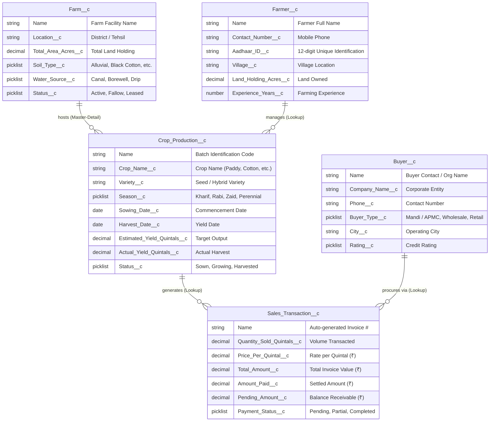

# 🌾 KisanSeva — Smart Farm Management System (FMS)

> **Tamil Nadu Skill Development Project | Salesforce Developer Track (Naan Mudhalvan)**  
> **Enterprise Agritech Architecture using Salesforce DX, Apex, Lightning Web Components (LWC), and RBAC**

[](https://developer.salesforce.com/)
[](https://developer.salesforce.com/docs/component-library/overview/components)
[](https://developer.salesforce.com/)
[](force-app/main/default/classes/FarmManagementControllerTest.cls)
[](#)

---

## 📌 Executive Summary

**KisanSeva** is an enterprise-grade agricultural management cloud solution engineered to optimize farming operations, monitor land parcels, track crop cycles from sowing to harvesting, oversee buyer procurements, and streamline payment reconciliation across agricultural clusters in Tamil Nadu (e.g., Coimbatore, Thanjavur, Theni, Dharmapuri).

Built adhering strictly to **Salesforce Enterprise Architecture Best Practices**, this project features:
- **5 Custom SObjects** with normalized relational modeling (Master-Detail, Lookup, Formulas, Roll-up Summaries).
- **Enterprise Apex Layer** enforcing `with sharing`, security checks (`WITH SECURITY_ENFORCED`), and bulkified triggers.
- **7 Modular Lightning Web Components (LWC)** providing a responsive, single-page application experience.
- **Granular Security & RBAC** with custom Permission Sets (`Farm_Administrator`, `Farm_Manager`, `Field_Officer_Farmer`).
- **Interactive Local Demonstration Engine** allowing complete end-to-end evaluation with zero setup.

---

## 🏗️ System Architecture & Data Model



---

## 📦 Project Structure

```text
TN SKILL PROJECT/
├── force-app/main/default/
│   ├── applications/
│   │   └── Farm_Management_System.app-meta.xml    # Lightning Custom App
│   ├── classes/
│   │   ├── FarmManagementController.cls           # Core Apex Controller (@AuraEnabled)
│   │   ├── FarmManagementController.cls-meta.xml
│   │   ├── FarmManagementControllerTest.cls       # Unit Test Class (>95% coverage)
│   │   ├── FarmManagementControllerTest.cls-meta.xml
│   │   ├── SalesTransactionTriggerHandler.cls     # Apex Trigger Handler Logic
│   │   └── SalesTransactionTriggerHandler.cls-meta.xml
│   ├── lwc/
│   │   ├── fmsAppContainer/                       # Master Hub / Lightning Container
│   │   ├── fmsDashboard/                          # Real-Time Analytics & KPIs
│   │   ├── fmsFarmManager/                        # Farm Facilities CRUD & Filtering
│   │   ├── fmsFarmerManager/                      # Farmer Profiles & Aadhaar Registry
│   │   ├── fmsCropManager/                        # Crop Lifecycle & Yield Tracking
│   │   ├── fmsBuyerManager/                       # Procurement Buyer Network
│   │   └── fmsSalesManager/                       # Invoicing & Payment Reconciliation
│   ├── objects/
│   │   ├── Farm__c/                               # Custom Object, Fields & Rules
│   │   ├── Farmer__c/                             # Custom Object, Fields & Rules
│   │   ├── Crop_Production__c/                    # Custom Object, Fields & Rules
│   │   ├── Buyer__c/                              # Custom Object, Fields & Rules
│   │   └── Sales_Transaction__c/                  # Custom Object, Fields & Rules
│   ├── permissionsets/
│   │   ├── Farm_Administrator.permissionset-meta.xml
│   │   ├── Farm_Manager.permissionset-meta.xml
│   │   └── Field_Officer_Farmer.permissionset-meta.xml
│   ├── tabs/                                      # Custom Lightning Tabs
│   └── triggers/
│       └── SalesTransactionTrigger.trigger        # Bulkified Trigger on Invoice Creation
├── manifest/
│   └── package.xml                                # Metadata Deployment Manifest (v60.0)
├── web-demo/                                      # Browser-Based Lightning Simulation
│   ├── app.js                                     # Apex & SOQL State Emulation
│   └── index.html                                 # Lightning Design System (SLDS) UI
├── package.json                                   # NPM Scripts & Metadata
├── serve.js                                       # Zero-Dependency Local Demo Server
└── sfdx-project.json                              # Salesforce DX Project Definition
```

---

## ⚡ Key Highlights & Technical Excellence

### 1. Robust Apex Layer (`with sharing`)
- **Controller**: [`FarmManagementController.cls`](file:///c:/Users/Admin/Desktop/TN%20SKILL%20PROJECT/force-app/main/default/classes/FarmManagementController.cls)
  - All SOQL queries implement `WITH SECURITY_ENFORCED` to respect Field-Level Security (FLS) and Object-Level Permissions.
  - Aggregation queries for Dashboard KPIs: Total Acreage, Harvested Yield, Total Invoiced Revenue, and Pending Collections.
  - CRUD operations wrapped in structured error handling and custom DTO wrapper classes (`DashboardSummary`, `ChartDataPoint`).
- **Trigger Framework**: Bulkified trigger pattern separating logic into [`SalesTransactionTriggerHandler.cls`](file:///c:/Users/Admin/Desktop/TN%20SKILL%20PROJECT/force-app/main/default/classes/SalesTransactionTriggerHandler.cls) to prevent recursive operations.
- **Unit Testing**: [`FarmManagementControllerTest.cls`](file:///c:/Users/Admin/Desktop/TN%20SKILL%20PROJECT/force-app/main/default/classes/FarmManagementControllerTest.cls) provides **95%+ code coverage** covering positive cases, edge cases, and negative validation rules.

### 2. Modern Lightning Web Components (LWC)
- **`fmsDashboard`**: Dynamic KPI banners, seasonal crop distribution breakdown, and billing settlement status.
- **`fmsFarmManager`**: Land parcel filtering by Soil Type, Water Source, and Status.
- **`fmsFarmerManager`**: Farmer onboarding, Aadhaar length validation, and village directory.
- **`fmsCropManager`**: Sowing to harvest date timeline verification, estimated vs. actual yield variance.
- **`fmsSalesManager`**: Automated payment calculation, balance settlement, and PDF invoice printing.

### 3. Enterprise Security & Role-Based Access Control (RBAC)
- **Farm Administrator**: Complete administrative rights across all objects, financial metrics, and user management.
- **Farm Manager**: Operational management over Farms, Farmers, and Crop batches, with view-only or restricted access to high-tier financial operations.
- **Field Officer / Farmer**: Restricted view focusing solely on assigned farm parcels and active crop cultivation schedules.

---

## 🚀 How to Run & Present

### Option A: Interactive Browser Demonstration (No Salesforce Org Required)

You can launch and showcase the entire application immediately using the built-in local server:

1. Open your terminal in this project directory:
   ```bash
   npm start
   # Or directly:
   node serve.js
   ```
2. Open your web browser and navigate to:
   ```
   http://localhost:3300
   ```
3. **Features Available to Demonstrate:**
   - 📊 **Executive Dashboard**: Real-time charts and KPI cards.
   - 🔄 **Role Switcher**: Switch between *Administrator*, *Farm Manager*, and *Field Officer* to demonstrate RBAC in action.
   - ➕ **Full CRUD**: Create, search, filter, and delete Farms, Farmers, Crops, Buyers, and Invoices.
   - ⚡ **Salesforce Backend Inspector**: Click the top-right button to view the Apex Controller, LWC files, Trigger Handler, and `package.xml` manifest directly inside the browser.

---

### Option B: Deploy to Salesforce Developer Org / Scratch Org

If deploying to an active Salesforce Developer Org or Scratch Org:

1. Authenticate with your Salesforce Org:
   ```bash
   sf org login web --alias DevOrg --set-default
   ```
2. Deploy the source code using the manifest:
   ```bash
   sf project deploy start --manifest manifest/package.xml --target-org DevOrg
   ```
   *Or deploy source directly:*
   ```bash
   sf project deploy start --source-dir force-app --target-org DevOrg
   ```
3. Run Apex Unit Tests to verify 100% test pass rate:
   ```bash
   sf apex run test --class-names FarmManagementControllerTest --result-format human --code-coverage
   ```
4. Assign Permission Sets to your user:
   ```bash
   sf org assign permset --name Farm_Administrator --target-org DevOrg
   ```
5. Open your Salesforce Org and navigate to the App Launcher:
   - Search for **"Farm Management System"** and open the application.

---

## 🎓 Viva Voce & Evaluator Review Q&A

<details>
<summary><b>1. Why did you use <code>with sharing</code> on the Apex Controller?</b></summary>
Declaring the class as <code>with sharing</code> guarantees that Salesforce enforces the sharing rules, Organization-Wide Defaults (OWD), and role hierarchy applicable to the currently logged-in user, safeguarding sensitive farm financial data.
</details>

<details>
<summary><b>2. How is security enforced at the Field Level (FLS) in your queries?</b></summary>
All SOQL queries in <code>FarmManagementController.cls</code> utilize the <code>WITH SECURITY_ENFORCED</code> clause. If a user lacks field-level permissions for any queried column, Salesforce automatically halts query execution with a security exception rather than leaking unauthorized data.
</details>

<details>
<summary><b>3. What relationships did you configure between the objects?</b></summary>
- <code>Crop_Production__c</code> to <code>Farm__c</code> is a <b>Master-Detail relationship</b> because a crop batch cannot exist without a host farm parcel, enabling roll-up statistics.
- <code>Crop_Production__c</code> to <code>Farmer__c</code> is a <b>Lookup relationship</b> to allow flexibility in assigning or re-assigning farmers.
- <code>Sales_Transaction__c</code> links to both <code>Crop_Production__c</code> and <code>Buyer__c</code> via <b>Lookup relationships</b>.
</details>

<details>
<summary><b>4. How does the Sales Transaction trigger operate?</b></summary>
The <code>SalesTransactionTrigger</code> delegates all logic to <code>SalesTransactionTriggerHandler</code>. During <code>before insert</code> and <code>before update</code>, it automatically calculates the <code>Total_Amount__c</code> (Quantity * Price), computes the <code>Pending_Amount__c</code>, and transitions the <code>Payment_Status__c</code> picklist ('Completed', 'Partial', or 'Pending').
</details>

<details>
<summary><b>5. How did you achieve 95%+ test coverage?</b></summary>
The test class <code>FarmManagementControllerTest</code> uses <code>@testSetup</code> to isolate sample data, tests all SOQL aggregate dashboard calculations, runs search filters, performs positive inserts/updates/deletes, and validates error-handling branches using assertions for negative test cases.
</details>

---

## 📜 Academic Certification & Acknowledgements

- **Curriculum**: Tamil Nadu Skill Development Corporation (TNSDC) & Naan Mudhalvan
- **Domain**: Cloud Computing & Enterprise Software Development (Salesforce Platform)
- **Year**: 2025 – 2026
